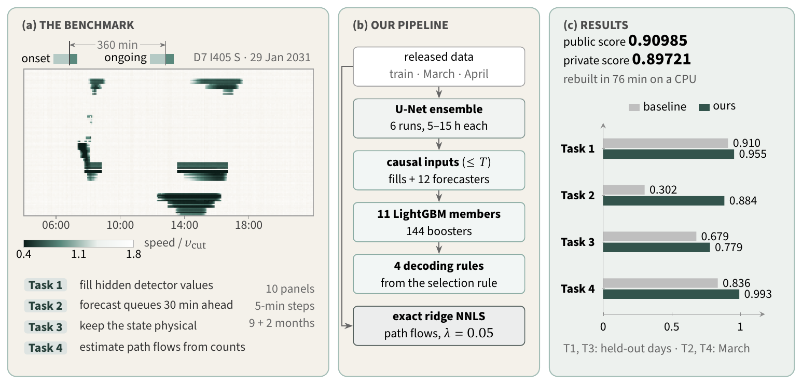
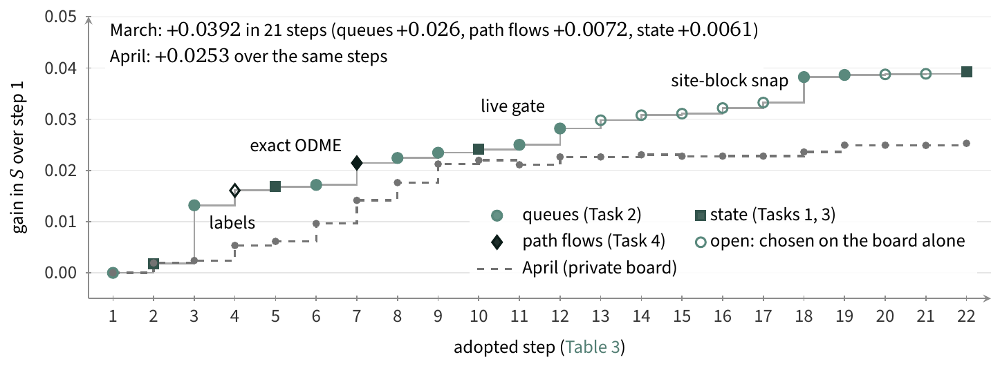
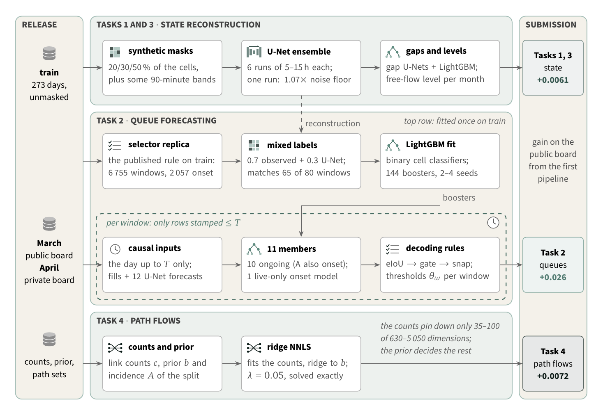

<p align="center">
  
</p>

<p align="center">
  
  
  
  
  
  
</p>

This repository rebuilds the two final submissions of team **Lukas** (Kaggle user `lukasbuck`) for
[TrafficFlowBench 2026](https://www.kaggle.com/competitions/2026-ieee-big-data-traffic-flow-bench) (IEEE BigData Cup) from the
released data and the shipped models: one script, CPU only, about 76 minutes. Method, analysis and results are in
[`REPORT.pdf`](REPORT.pdf).



## 🏁 Final submissions

| Final | Kaggle submission | Content | Public score (March) | Private score (April) |
| --- | --- | --- | --- | --- |
| A | `cand_lFbo2bs_qfswap_kcp11_lvl` | the pipeline below | 0.90985 | 0.89715 |
| B | `cand_finalB_nodormant_lvl` | A plus rolling in-month recurrence for the April windows | 0.90985 | **0.89721** (counted, rank 10 of 802) |

Both files as submitted are attached to the [v1.0 release](https://github.com/L4XB/trafficflowbench-solution/releases/tag/v1.0)
(`final_A_cand_lFbo2bs_qfswap_kcp11_lvl.zip`, `final_B_cand_finalB_nodormant_lvl.zip`). They are identical on March, the public board.
A CPU rebuild with this code reproduces them up to a few queue cells; on the private board the rebuilds score 0.89713 (A) and
0.89723 (B), within 0.002 % of the selected files. See
[Package versus submitted files](#-reproducibility) for the one code difference and why it exists.

<details>
<summary>How the score grew: +0.0392 in 21 adopted steps on March, +0.0253 on April</summary>



Filled markers rest on a local test, open markers on the public board alone; the dashed line is the private (April) board, revealed
after the deadline (Table 3 and Section 6.6 of the report).
</details>

## 🚗 Quick start

```bash
# 1. environment: Python 3.12 with the pinned versions
python3.12 -m venv .venv && . .venv/bin/activate
pip install -r requirements.txt

# 2. data: unzip the Kaggle release (Data page) so that data/kaggle_public/sample_submission.csv exists

# 3. models: trafficflowbench-models.tar.xz (2.0 GB) from the v1.0 release, unpacked in the repository root
shasum -a 256 trafficflowbench-models.tar.xz
# 1ebf42c68c0fa21dc7e094ffe8928c1daa3c69f03196c8dbdbc553cfed949585
tar -xJf trafficflowbench-models.tar.xz          # adds results_top3/ and cache_top3/

# 4. run: writes submission/submission_A.csv and submission/submission_B.csv
PY=$PWD/.venv/bin/python bash run_all.sh         # CPU; DEVICE=cuda or DEVICE=mps for the U-Nets
```

Nothing is trained in this run; every network and booster is loaded from the archive. GNU tar on Linux prints "Ignoring unknown
extended header keyword" for the archive's macOS metadata; the warnings are harmless.

| | |
| --- | --- |
| Runtime | 75 to 77 min in three clean-room runs: array cache 12, Task-1 state 26, Task-2 inputs 8, queue members 17, decoding < 1, ODME 9, assembly 3 |
| Hardware | Ubuntu 24.04, AMD Ryzen 5 PRO 4650G (8 of its 12 hardware threads), 22 GB RAM, no GPU; also verified on macOS (Apple M2 Pro) |
| Memory | about 12 GB resident at peak with the default `WORKERS=1`; each additional cache worker adds up to 8 GB |
| Disk | release 12 GB, unpacked models 4.3 GB; 40 GB free recommended |

## 🛣️ How it works



1. **Array cache** of the release (`tfb/cache/`).
2. **Tasks 1 and 3, state:** mean of six U-Net inpainting models, a two-stage LightGBM corrector for the spans blanked after each
   Task-2 horizon (`tfb/state/blackout_apply.py`), and a free-flow level correction (`tfb/state/level_apply.py`).
3. **Task 2 inputs:** per window, U-Nets fill the 60-minute history and forecast T+5..T+30 from a copy of the day in which every row
   after the origin T is hidden (`tfb/queue/fill_causal.py`, `tfb/queue/fill_qh.py`).
4. **Task 2 members:** eleven LightGBM members give per-cell, per-step queue probabilities (`tfb/queue/final.py --reuse`).
5. **Task 2 decoding** (`tfb/decode/`): onset windows use an expected-IoU decode, a live-signal cluster gate and a snap to the
   corridor's onset blocks; ongoing windows use the mean of ten members with thresholds from the month's congestion level so far and
   the window's selection kind. Final B adds one rule for the April windows only: the eight members with in-month features see the
   16 days before the window's day, completed with the end of March.
6. **Task 4, path flows:** ridge NNLS toward the split's released prior on its released link counts, lambda 0.05 (`tfb/odme/ridge.py`).
7. **Assembly** into the upload format (`tfb/assemble.py`).

## 🔁 Reproducibility

Expected outputs (sha256), reproduced bit for bit by the clean-room runs of 2026-11-01 and 2026-11-02 (fresh clone, venv from
`requirements.txt`, model archive from the release):

| File | sha256 |
| --- | --- |
| `submission/submission_A.csv` | `825e59fd391f3104ac8c8b50decebccb5add244d7ecbb2dad308bb68f188ed76` |
| `submission/submission_B.csv` | `decf1e0b4ae044febb1161d9505a849fc904d656cd1a0a2f78599e7898e03497` |

Compare a rebuild with the files selected on Kaggle (zips from the release):

```bash
python tools/compare_submission.py --ours submission/submission_A.csv --ref final_A_cand_lFbo2bs_qfswap_kcp11_lvl.zip
python tools/compare_submission.py --ours submission/submission_B.csv --ref final_B_cand_finalB_nodormant_lvl.zip
```

| Block | Final A | Final B |
| --- | --- | --- |
| state rows (6,735,795) | speed: 23 rows differ by more than 1e-3 km/h (max 0.29); flow: RMS 8.5e-4 veh/h (max 1.7) | same as A |
| queue cells, March (87,000) | 9 differ | 9 differ |
| queue cells, April (87,000) | 4 differ | 11 differ |
| path flows (70,708) | identical | identical |

**Package versus submitted files.** This code differs from the code that built the submitted files in one respect: after submission,
each window's Monte-Carlo decode got its own random stream (seeded with crc32 of the window id), because the time-rule test showed that
a shared stream made a window's forecast depend on which other windows the run contained. Together with floating-point flips between
the Apple GPU that built the submitted files (CSV sha256 `604893761b960a85…` for A, `d95f485305e6689c…` for B) and a CPU, a rebuild
differs in 4 (A) and 11 (B) of the 87,000 April queue cells, which can move the private score by at most 0.00015 (A) and 0.00032 (B),
far inside the 1 % rule.

In detail: the seed change moves 3 onset cells in two March windows and no April cell; the flips, at LightGBM split thresholds that are
met almost exactly, account for 6 March cells and all April cells. Uploaded as a check, the CPU rebuilds of A and B scored 0.90517 on
the public board against 0.90985; about 0.0044 of the difference comes from the two March windows, in which two candidate sets have
nearly the same expected IoU. On the private board, which the 1 % rule refers to, they scored 0.89713 (A) and 0.89723 (B) against
0.89715 and 0.89721 for the selected files.

## 🚦 Task-2 time rule

Every Task-2 input of a window comes from rows stamped at or before its origin T: the window history, the row at T, earlier days of the
same split, earlier splits, the train split and the origins of earlier windows. The U-Nets that fill the history see a copy of the day
with all rows after T removed.

`tools/causality_test.sh` reruns the Task-2 part of the pipeline on copies of the release in which every row of one split after a cut
time is removed, and compares the forecasts of all windows with origin at or before the cut. At ten cuts, each the origin of one
window (four in March, six in April, the last one covering all 160 windows), none of the 877,752 compared cells differs, for either
final.

<details>
<summary>The two commands</summary>

```bash
SPLIT=validation CUTS="2031-03-01T09:10:00Z 2031-03-01T10:05:00Z 2031-03-01T14:15:00Z 2031-03-02T17:15:00Z" bash tools/causality_test.sh
bash tools/causality_test.sh   # private split: 2031-04-01 19:05, 04-02 07:30 (files deleted), 04-03 09:20, 04-05 16:05, 04-07 14:00, 04-17 15:15
```
</details>

## Repository layout

| Path | Content |
| --- | --- |
| `run_all.sh` | single entry script: release and shipped models to `submission/submission_A.csv` and `submission_B.csv` |
| `tfb/` | source code, one package per stage, every module runs as `python -m tfb.<package>.<module>` from the repository root |
| `tfb/cache/`, `tfb/state/` | array cache; Task 1: U-Nets, blackout corrector, free-flow level correction |
| `tfb/labels/`, `tfb/queue/`, `tfb/decode/` | Task 2: train labels and selector replica, causal inputs and LightGBM members, decoding rules |
| `tfb/odme/`, `tfb/assemble.py`, `tfb/scoring.py` | Task 4, submission assembly, local re-implementation of the score |
| `tools/` | time-rule test (`causality_test.sh`) and the comparison with the submitted files (`compare_submission.py`) |
| `config/holdout31.json` | the 31 held-out train days used for model selection |
| `docs/TRAINING.md` | every training command with seeds and schedules |
| `results_top3/`, `cache_top3/` | trained models and train-derived labels from the model archive (not in git) |

## Training, seeds and licences

- **Training from scratch:** `docs/TRAINING.md` lists every training command with seeds and schedules. The U-Nets were trained on
  Apple MPS with wall-clock budgets, so a retrained ensemble differs slightly from the shipped one; the weights are therefore part of
  the model archive.
- **Determinism:** the run loads every model, and the expected-IoU decode seeds one generator per window with crc32 of the window id,
  so a window's decode does not depend on which other windows the run contains.
- **External data:** none, and no pretrained models; every model was trained on the released train split only.
- **Licences:** MIT (`LICENSE`). `tfb/odme/baseline_io.py` re-implements four file readers of the organisers' public baseline
  (github.com/jacky850/trafficflowbench-public, MIT licence).

<details>
<summary>Model naming: report to code</summary>

| Report | Run directory `results_top3/queue/final_*` | Features | Forecasts | Fit |
| --- | --- | --- | --- | --- |
| A (+ production onset) | `v27mixcausal` | v6 (base + in-month) | none | pooled |
| B | `v28fc` (+ fold runs `_e1`..`_e3`) | v6 | U-Net speed | pooled |
| C | `v31qf` (+ fold runs) | v6 | queue-focused U-Net speed | pooled |
| D | `Dnc` (+ fold runs) | v6 | L1 U-Net speed | pooled |
| V2 | `v2og` | v2 (base) | none | pooled |
| AP, BP, CP, DP | `APnc`, `BPnc`, `CPqf`, `DPnc` | as A to D | as A to D | per panel |
| V2P | `V2Pnc` | v2 | none | per panel |
| live gate model | `v27live` | v6 without climatology, link identity and static attributes | none | pooled |
</details>
